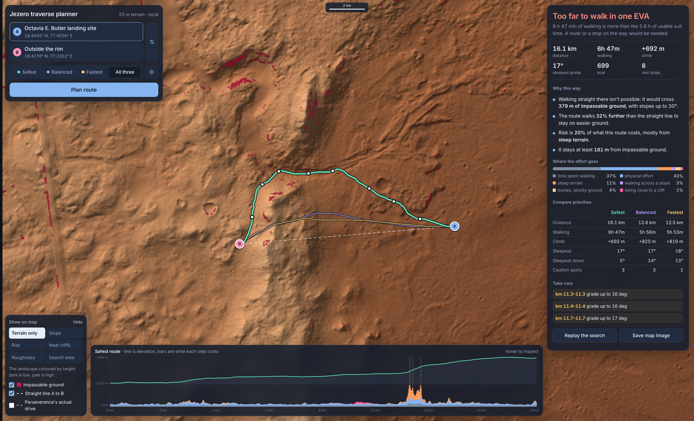

# Jezero traverse planner

Finds the safest walking route between two points in **Jezero crater, Mars**, for an
astronaut in a pressure suit, and explains why it chose that route.

It uses no machine learning and no training: real NASA/USGS elevation data, a
physics-based model of effort and risk, and A* graph search. Every route can be
explained step by step.



## Quick start
```bash
git clone <this repo>
cd jezero_pathfinder
python3 -m venv .venv
source .venv/bin/activate          # Windows: .venv\Scripts\activate
pip install -r requirements.txt
python get_data.py                 # downloads the 90 MB elevation model (once)
python app.py                      # opens http://localhost:8050
```
The first start renders the map layers once (about 30 s). Python 3.9 or newer.

## What's in here
| file | what it does |
|---|---|
| `terrain.py` | Loads the elevation model and derives slope, roughness, cliffs, impassable cells and distance to hazard |
| `planner.py` | The cost model (time, energy, risk), the A* search, smoothing, per-step cost breakdown and the mission report |
| `app.py` | Local HTTP server: serves the map UI and a JSON API (see **[API.md](API.md)**) |
| `app_ui.html` | The browser map UI |
| `plan.py` | Command-line planner that writes PNG maps and GeoJSON |
| `viz.py` | Matplotlib map rendering |
| `get_data.py` | Downloads the public data into `data/` |
| `web/` + `export_web.py` | A self-contained in-browser version (80 m, no server) |
| `data/M20_waypoints.csv` | Perseverance's 708 logged positions (NASA), used for validation and the map overlay |

## Building your own UI or HUD
Run `python app.py --no-browser` and call the API from anything. **[API.md](API.md)** has
every endpoint and field. Typical flow:

1. `GET /meta` for the map size, landmarks and grid transform.
2. `GET /layer/relief.jpg` for a base map (or use your own).
3. `POST /plan` with `a_latlon` and `b_latlon` to get the route as lat/lon points, the
   elevation profile, per-step cost reasons, rest stops, caution segments and a verdict.
4. `GET /probe?r=&c=` for live ground readouts under a cursor or a position.

CORS is open. `--host 0.0.0.0` exposes it to other devices on your network.

## How a route is chosen
1. **Terrain layers:** slope (Horn method), roughness, local relief, and a no-go mask
   (slope over the limit, cliffs or scarps, missing data), plus distance to hazard for
   every 20 m cell.
2. **Graph:** each cell links to 16 neighbours (8 adjacent plus 8 knight's moves).
3. **Step cost** depends on direction (uphill is not the same as downhill):
   * **time:** Tobler hiking function, slowed by a 0.55 suit factor
   * **energy:** Minetti et al. (2002) metabolic cost vs gradient, scaled to Mars gravity
   * **risk:** steep ground, steep descents (fall risk), side-slope (balance), roughness,
     and closeness to cliffs
4. **A\*** with an admissible straight-line heuristic, so the route is optimal for the
   chosen weights. Profiles: `safest`, `balanced`, `fastest`.
5. **Smoothing** straightens grid zig-zags only where that crosses no hazard and costs no more.
6. **Report:** distance, time against the EVA budget (30 % reserve), energy, climb,
   steepest grades, nearest hazard, rest stops every ~45 min and caution segments.

## Data and validation
| source | what |
|---|---|
| USGS / JPL *Mars 2020 Science Investigation CTX DEM Mosaic* | Elevation of all of Jezero, 20 m/px, 89 × 101 km |
| NASA Mars 2020 mission map (MMGIS) | Perseverance waypoints, sols 13-2022, with rover tilt |

The rover log is only used to check the model, never to tune it. DEM slope matches
Perseverance's measured tilt with r = 0.80, and only 3 of 708 rover positions fall on
cells the model calls impassable (26-31° rim slopes: drivable for a rover, too steep on foot).
On the landing site to western rim trip, the `safest` route follows a northern gap close to
the path NASA actually drove.

## Command line
```bash
python plan.py --list
python plan.py --from landing --to beyond_rim --compare
python plan.py --from 18.4446,77.4509 --to 18.4900,77.3470 --profile balanced --max-slope 20
```

## Limits
* 20 m resolution: boulders, small rocks and sand under ~20-40 m are invisible. Check
  routes against HiRISE imagery (0.25 m) or the 1 m HiRISE DTM.
* Suit speed, energy and slope limits are reasonable assumptions, not mission specs.
  Change them in `Astronaut` in `planner.py`.
* No illumination, dust or comms line-of-sight model yet.

## Credits
Elevation data: USGS Astrogeology Science Center / NASA JPL. Rover track: NASA/JPL-Caltech
Mars 2020 mission. Both are public domain US government data.
