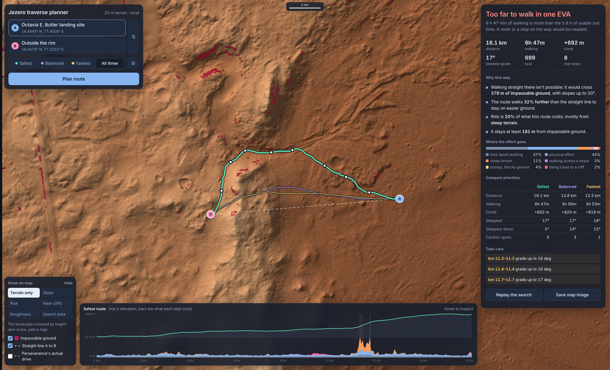
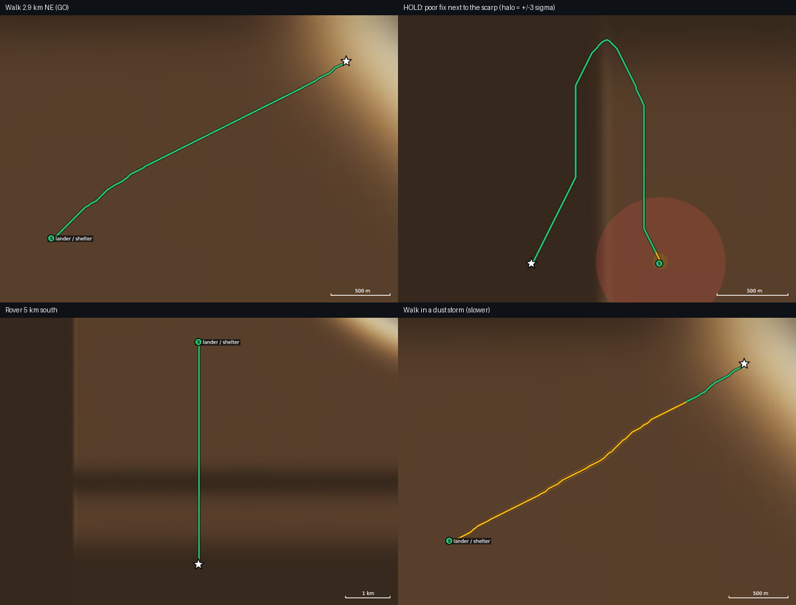
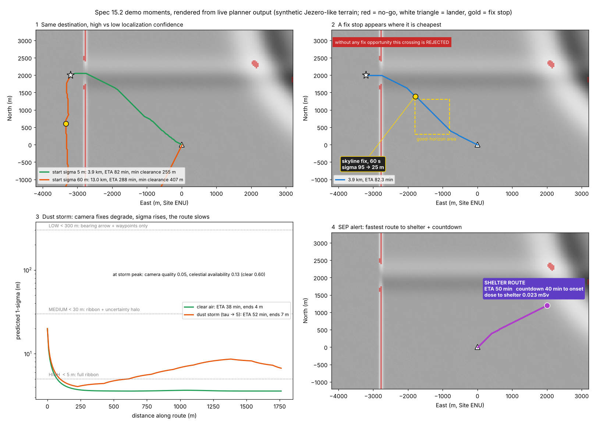

# Jezero traverse planner

Finds the safest walking route between two points in **Jezero crater, Mars**, for an
astronaut in a pressure suit, and explains why it chose that route.

It uses no machine learning and no training: real NASA/USGS elevation data, a
physics-based model of effort and risk, and A* graph search. Every route can be
explained step by step.



## Quick start
```bash
git clone <this repo>
cd jezero_pathfinder
python3 -m venv .venv
source .venv/bin/activate          # Windows: .venv\Scripts\activate
pip install -r requirements.txt
python get_data.py                 # downloads the 90 MB elevation model (once)
python app.py                      # opens http://localhost:8050
```
The first start renders the map layers once (about 30 s). Python 3.9 or newer.

## What's in here
| file | what it does |
|---|---|
| `terrain.py` | Loads the elevation model and derives slope, roughness, cliffs, impassable cells and distance to hazard |
| `planner.py` | The cost model (time, energy, risk), the A* search, smoothing, per-step cost breakdown and the mission report |
| `app.py` | Local HTTP server: serves the map UI and a JSON API (see **[API.md](API.md)**) |
| `app_ui.html` | The browser map UI |
| `plan.py` | Command-line planner that writes PNG maps and GeoJSON |
| `viz.py` | Matplotlib map rendering |
| `get_data.py` | Downloads the public data into `data/` |
| `web/` + `export_web.py` | A self-contained in-browser version (80 m, no server) |
| `data/M20_waypoints.csv` | Perseverance's 708 logged positions (NASA), used for validation and the map overlay |


## New: lander terminal (AI layer + planner)

```
python app.py --synthetic        # opens http://localhost:8050 on built-in test terrain
python app.py                    # same, on the real Jezero DEM (run `python get_data.py` once first)
```
The page opens as the **lander terminal** (spec Section 2). Type what you want to do, for example
*"Collect carbonate samples near the delta, two hours max."* The AI layer turns it into a structured request (shown on a card you can edit),
the planner runs on every candidate site, and you get the top sites with plain-language reasoning and numbered pins on the map.
Say *"option 2"* (or click a pin) and then *"confirm"*: only then is the route planned. Then use the **en-route events**
(advance the crew, dust storm, SEP alert, new hazard) to see the system replan from where the crew actually is.
Follow-ups work too: *"use the rover instead"*, *"make it 90 minutes"*, *"safest route"*, *"help"*, *"cancel"*.
The **Manual planner** tab still has the click-the-map controls. The first start on the real terrain also renders the full-resolution map picture
(a few seconds; it is then cached in the `data` folder).

**How the route was calculated.** Under every route the terminal shows its working (or say *"explain"*): a numbered recipe with this run's own
numbers (terrain read, cost of a step, the search, the refinement, the independent check, why not a straight line); a chart of where the cost
comes from along the route (time, energy, risk, localization penalty, fix stops; hover it to inspect any point, which is marked on the map);
a chart of the crew's position error against the safety buffer it must stay inside; **Replay the search**, which animates the states A* actually
expanded, coloured by predicted position error; and **Compare priorities**, which plans the same trip with each profile so you can see what the
weights change. The ingredients are recomputed from the finished route with the same physics as the search (their sums match the route's time and
energy), not written afterwards.

**How the AI layer behaves (spec Section 6):** it only converts words into a schema-validated request. It cannot set slopes, dose limits,
return margins or consumables (such fields are stripped and shown as a GUARDRAIL warning), and every number you see comes from the planner.
By default it is a deterministic **offline parser** (no model, no network, as the spec requires). Optionally a language model can be plugged in
behind the same guardrails, and it falls back to the offline parser if it fails:
```
set JEZERO_LLM=ollama            # local model via Ollama (spec-consistent: on the lander, offline). Optional: JEZERO_LLM_MODEL=llama3.2
set JEZERO_LLM=anthropic         # cloud API; needs ANTHROPIC_API_KEY. NOT offline, so it breaks the spec's "no Earth link" requirement
python app.py --synthetic
```
(The LLM adapters are tested against mock servers only; I could not call a real model from the build environment.)
The **science catalogue is illustrative**: site tags are hand-assigned from published Jezero unit descriptions, not read from the CRISM / geologic-map layers.
The microphone button uses the browser's speech recognition, which in Chrome is an online service and therefore not offline.

## Spec-compliant mission planner

**Interactive map (the easiest way to use it):**
```
python app.py --synthetic        # opens http://localhost:8050 - no DEM download needed
python app.py                    # same, on the real Jezero DEM (run `python get_data.py` once first)
```
Click the map to set the goal, pick walk or rover, set how well the crew knows its position, optionally add a dust storm,
a solar-particle-event forecast or hazards, and press **Plan optimal route**. The page shows the route coloured by predicted
position confidence, its uncertainty halo, fix stops, the turn-back point, consumables, return margin and any alerts.
Points far from the lander are refused with an explanation (the real-EVA rule that the crew must always be able to get home);
untick **require a safe return to the lander** to plan a plain start-to-goal path anywhere.
The original planner is still available at `/classic`. (No HUD or other subsystems are shown; only the planner's result.)




`mission_planner.py` implements the path-planning side of the *Mars Surface Navigation System* design
specification: uncertainty-aware hazard buffers, localization-aware routing with optimised fix stops,
hierarchical coarse-to-fine search, D* Lite replanning, walking **and** rover modes, return-to-shelter /
consumables / SEP constraints, and the spec's Site-ENU JSON contracts. See **[SPEC_COMPLIANCE.md](SPEC_COMPLIANCE.md)**
for the section-by-section matrix, what is *not* covered, and the caveats.

```
python plan_mission.py --goal 2500,1500                    # walk, min-ETA, ENU metres from the lander
python plan_mission.py --goal 7000,7000 --mode rover
python plan_mission.py --goal 2500,1500 --sigma 60         # low position confidence -> wider buffers
python plan_mission.py --sep-alert 90 --from 2000,1200     # SEP in 90 min: fastest route to shelter
python plan_mission.py --synthetic --goal 2500,1500        # no DEM download needed
python tests/test_spec.py                                  # 14 groups of spec checks (~35 s)
python tests/bench_spec.py                                 # SYS-2 / SYS-3 timing
python demo_moments.py                                     # the four demo moments of spec 15.2
```



New JSON endpoints on the same server (`python app.py`): `POST /mission/plan`, `/mission/replan`, `/mission/rank`
(see [API.md](API.md)).

| file | what it does |
| --- | --- |
| `frames.py` | the single Site ENU frame |
| `localization.py` | sigma model, confidence levels, localizability layer, Localization -> planner contract |
| `environment.py` | dust / temperature / wind, SEP and dose, consumables |
| `kernels.py` | numba kernels: uncertainty-aware A* over (cell, sigma), return-to-shelter field |
| `mission_planner.py` | planner, independent verifier, shelter route, replan triggers, site ranking |
| `replan.py` | D* Lite |
| `ai_layer.py` | the AI layer: offline parser, optional LLM adapters, schema validation + guardrails, science catalogue |
| `mission_web.py`, `mission_ui.html` | the lander terminal and manual planner (map layers, probe, planner and AI endpoints) |

## Building your own UI or HUD
Run `python app.py --no-browser` and call the API from anything. **[API.md](API.md)** has
every endpoint and field. Typical flow:

1. `GET /meta` for the map size, landmarks and grid transform.
2. `GET /layer/relief.jpg` for a base map (or use your own).
3. `POST /plan` with `a_latlon` and `b_latlon` to get the route as lat/lon points, the
   elevation profile, per-step cost reasons, rest stops, caution segments and a verdict.
4. `GET /probe?r=&c=` for live ground readouts under a cursor or a position.

CORS is open. `--host 0.0.0.0` exposes it to other devices on your network.

## How a route is chosen
1. **Terrain layers:** slope (Horn method), roughness, local relief, and a no-go mask
   (slope over the limit, cliffs or scarps, missing data), plus distance to hazard for
   every 20 m cell.
2. **Graph:** each cell links to 16 neighbours (8 adjacent plus 8 knight's moves).
3. **Step cost** depends on direction (uphill is not the same as downhill):
   * **time:** Tobler hiking function, slowed by a 0.55 suit factor
   * **energy:** Minetti et al. (2002) metabolic cost vs gradient, scaled to Mars gravity
   * **risk:** steep ground, steep descents (fall risk), side-slope (balance), roughness,
     and closeness to cliffs
4. **A\*** with an admissible straight-line heuristic, so the route is optimal for the
   chosen weights. Profiles: `safest`, `balanced`, `fastest`.
5. **Smoothing** straightens grid zig-zags only where that crosses no hazard and costs no more.
6. **Report:** distance, time against the EVA budget (30 % reserve), energy, climb,
   steepest grades, nearest hazard, rest stops every ~45 min and caution segments.

## Data and validation
| source | what |
|---|---|
| USGS / JPL *Mars 2020 Science Investigation CTX DEM Mosaic* | Elevation of all of Jezero, 20 m/px, 89 × 101 km |
| NASA Mars 2020 mission map (MMGIS) | Perseverance waypoints, sols 13-2022, with rover tilt |

The rover log is only used to check the model, never to tune it. DEM slope matches
Perseverance's measured tilt with r = 0.80, and only 3 of 708 rover positions fall on
cells the model calls impassable (26-31° rim slopes: drivable for a rover, too steep on foot).
On the landing site to western rim trip, the `safest` route follows a northern gap close to
the path NASA actually drove.

## Command line
```bash
python plan.py --list
python plan.py --from landing --to beyond_rim --compare
python plan.py --from 18.4446,77.4509 --to 18.4900,77.3470 --profile balanced --max-slope 20
```

## Limits
* 20 m resolution: boulders, small rocks and sand under ~20-40 m are invisible. Check
  routes against HiRISE imagery (0.25 m) or the 1 m HiRISE DTM.
* Suit speed, energy and slope limits are reasonable assumptions, not mission specs.
  Change them in `Astronaut` in `planner.py`.
* No illumination, dust or comms line-of-sight model yet.

## Credits
Elevation data: USGS Astrogeology Science Center / NASA JPL. Rover track: NASA/JPL-Caltech
Mars 2020 mission. Both are public domain US government data.
